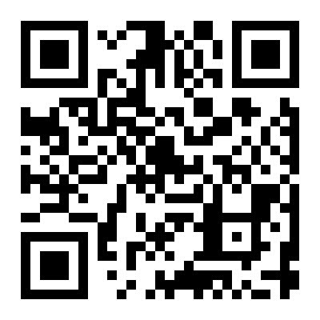
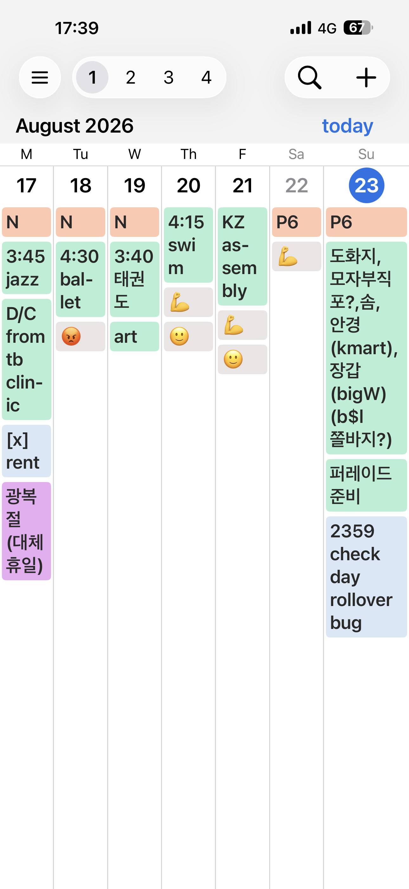
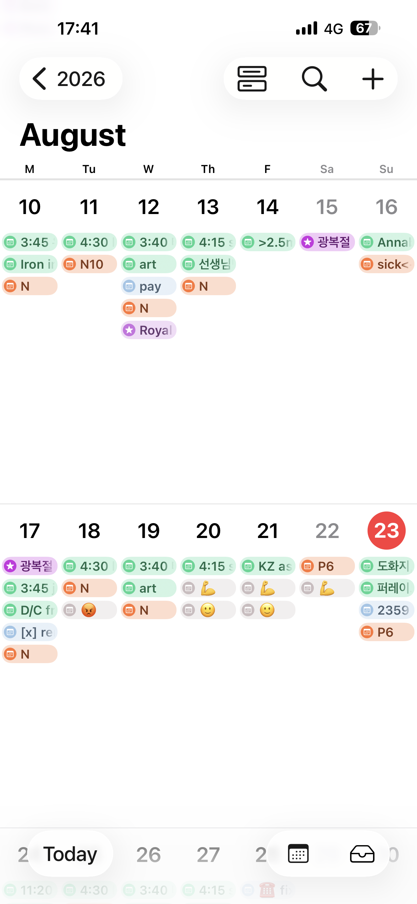
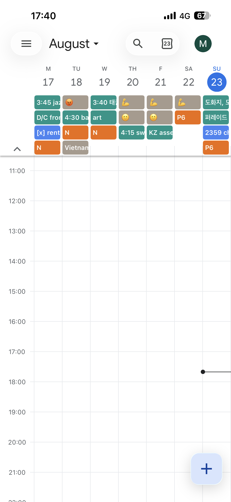

# Big Calendar

A calendar for iPhone that shows your event titles in full.

Big Calendar shows the calendars already on your device — iCloud, Google, and
anything else synced through iOS — in a clear week grid where long event titles
wrap onto multiple lines instead of being cut off, so you can read your weeks at
a glance.

## Features

- **Full, multi-line event titles** — long titles wrap onto as many lines as they
  need instead of ending in "…", so you see what each event actually is.
- **Multi-day events as bars** — trips and holidays stretch across the days they
  cover, and continue onto the next week's row.
- **Choose how many weeks to see** — view 1–2 weeks for free, or up to 4 weeks
  and the whole month with a one-time Pro upgrade (**Settings → Layout**).
- **Quick event details** — tap an event to see its details below the calendar,
  without losing your place.
- **Word replacements** — shorten long words in event titles (e.g. `birthday ->
  bday`, `movie -> 🍿`, `minho kim -> mk`) so more fits on screen. Handy in
  the 3–4 week and month views, where long titles get cut off to keep things readable.
- **Pick which calendars show** — turn calendars on/off and reorder them so the
  ones you care about appear first each day.
- **Australian holidays by state** — if you subscribe to the Australian Holidays
  calendar, show only the states you care about.

## How many lines a title gets

| Layout | Top week row | Other rows |
| :----- | :----------- | :--------- |
| 1–2 weeks | No limit | No limit |
| 3–4 weeks | No limit | 2 lines |
| Month | 2 lines | 2 lines |

"No limit" still stops a single event from growing taller than its week row.

## How events are ordered

Multi-day events always come first — they're drawn as bars at the top of each day.
Your calendar order from **Settings → Calendars** then applies to the remaining
single-day events. So the calendar order isn't followed 100%: multi-day events take
priority over it.

## Reminders

Reminders (from the iOS Reminders app) are not shown — Big Calendar displays
calendar events only.

## Pro

Big Calendar is free to use with a 1–2 week view. A single one-time purchase
unlocks the multi-week (3–4 week) and month views, and any future Pro features.
No subscriptions.

## Using with Google Calendar

Big Calendar shows the calendars already on your iPhone, so add your Google account to iOS first:

1. **Settings -> Apps -> Calendar -> Calendar Accounts -> Add Account -> Google**, and sign in.
2. Turn on the **Calendars** toggle.

Then open Big Calendar — your events appear. If the grid is empty, no account has been added yet (step 1).

**For timely updates:** Google calendars only refresh on a schedule, so if new events are slow to show, set **Settings -> Apps -> Calendar -> Calendar Accounts -> Fetch New Data -> Every 15 Minutes**.

## Screenshot Comparison

| Apple Calendar | Google Calendar | Big Calendar |
| :------------: | :-------------: | :----------: |
|  |  |  |

## Privacy

Big Calendar does not collect, store, or share any of your information. Your
calendar events are read on your device only, to display them — they never leave
your phone and are never sent to us or anyone else.

See the [Privacy Policy](privacy-policy.md) for details.

## Support

Questions, bugs, or ideas: [minho42+bigcalendar@gmail.com](mailto:minho42+bigcalendar@gmail.com)
