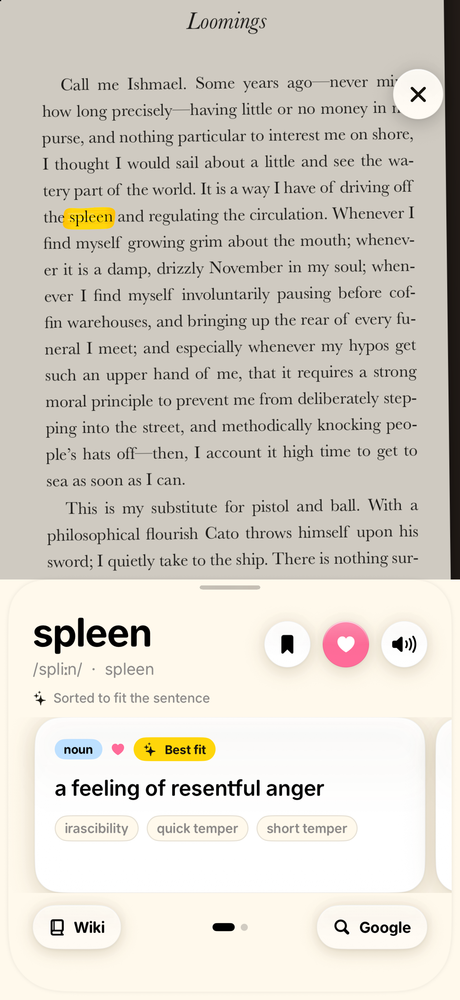

# Camtionary

A dictionary you point at the page. Reading a paper book? Aim your iPhone at the page and tap
any word: its meaning slides up, the one that fits the sentence first.

## Features

- Tap a word on the page, or hold a word and drag across a phrase like *upper hand*.
- The meaning that fits the sentence comes first, sorted on your iPhone by Apple
  Intelligence where it's available: *spleen* in Moby-Dick opens on bad temper, not the organ.
- Pronunciation, examples and words like it. Hear any word said aloud.
- Words broken over two lines are joined back up.
- Pinch to zoom up to 5×, and a torch for small print and dim rooms.
- Keep your words by book: photograph a book's cover or type its title, and the words you
  look up are saved under it, with the sentence you found them in.
- Export your words as a spreadsheet (CSV).
- Names, places and newer words come from Wikipedia and Wiktionary, and one tap searches
  Google for anything else.

Every feature is free, with 10 lookups a day. Camtionary Pro, a one-time purchase, removes
the daily limit.

The dictionary is English only, and works offline.

## Privacy

What the camera sees, and the sentences around a word, never leave your iPhone. Only the
word you look up is sent to Wikipedia and Wiktionary, and you can turn that off. No
accounts, ads or tracking. See the [privacy policy](privacy-policy.md).

## Support

Questions, bugs, or ideas: [minho42+camtionary@gmail.com](mailto:minho42+camtionary@gmail.com)
