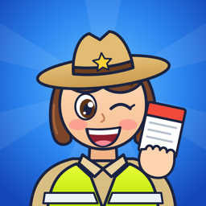
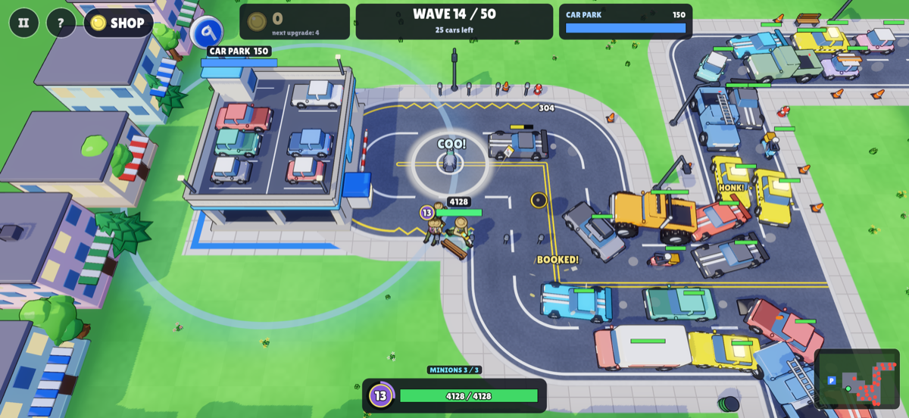
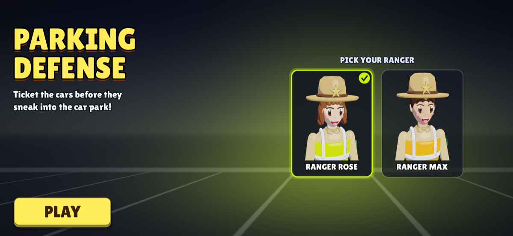

# Parking Defense

A tower defense game for iPhone: one parking ranger against a city full of illegal
parkers. Cars pour down two roads toward the car park, which has just 5 free spaces
(counted down on the green SPACES sign). Ticket them before they sneak in: when the
spaces are gone, or your ranger gets run over, the game ends.

Coming soon to the App Store.

## How to play

- **Move:** drag anywhere on the left half of the screen. Your ranger tickets the
  nearest car automatically.
- **FOCUS:** when the yellow button is charged and a car is in reach, tap it for a
  burst of rapid tickets.
- **BOMB:** tap to throw at the biggest jam, or drag from the button to aim.
- **BIRD:** throw a pigeon onto the road and cars stop in front of it for a few seconds.
- **SHOP:** tap your gold (or SHOP) to spend fines on upgrades. Your gold glows when
  you can afford one.
- **Minions** join your patrol at levels 4, 8 and 12.

## Privacy

Parking Defense is free and has no accounts. After your first 5 games it shows a
full-screen Google AdMob ad after a lost game; Google may use your device's advertising
identifier for this, if you allow it. See the [privacy policy](privacy-policy.md).

## Support

Questions, bugs, or ideas: [minho42+parkingdefense@gmail.com](mailto:minho42+parkingdefense@gmail.com)
